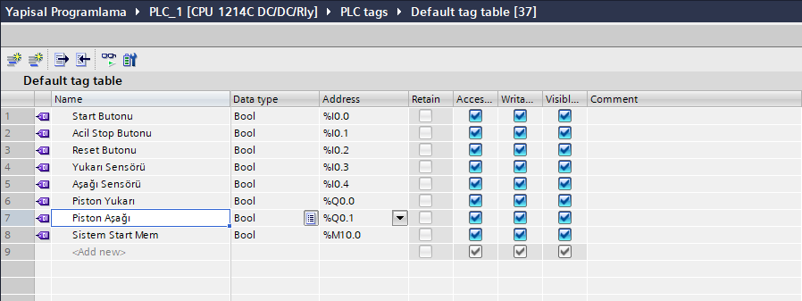
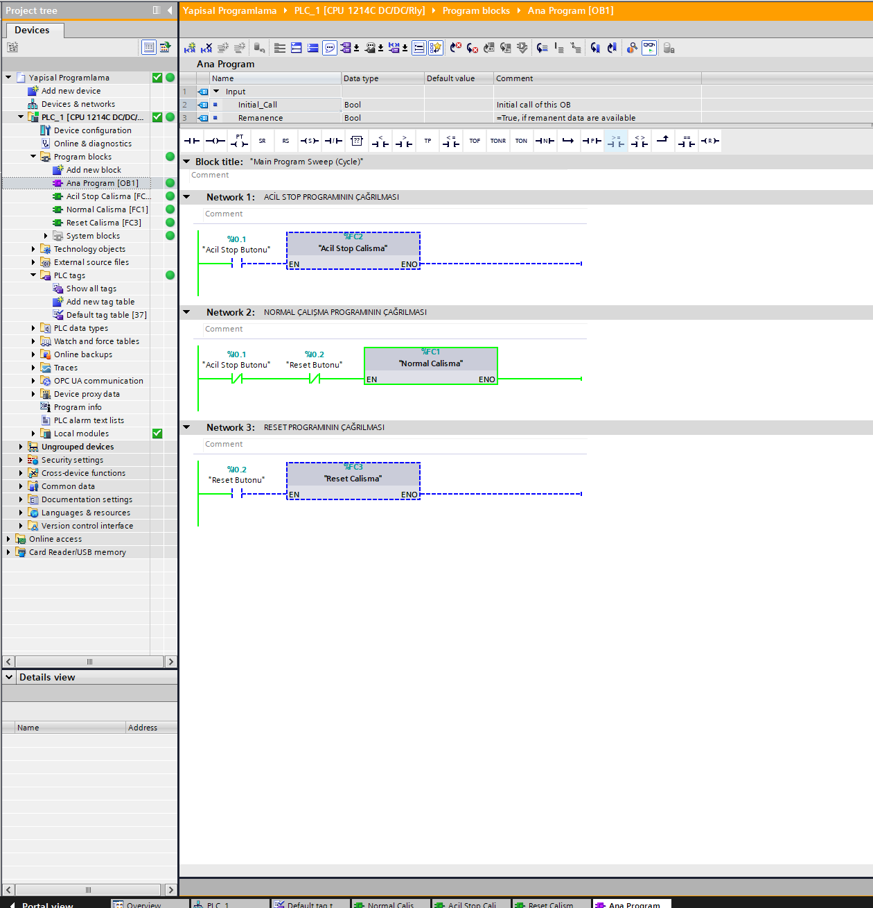
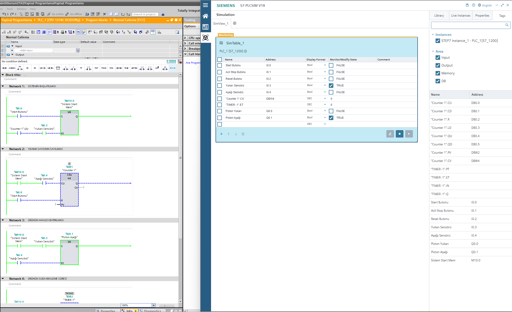
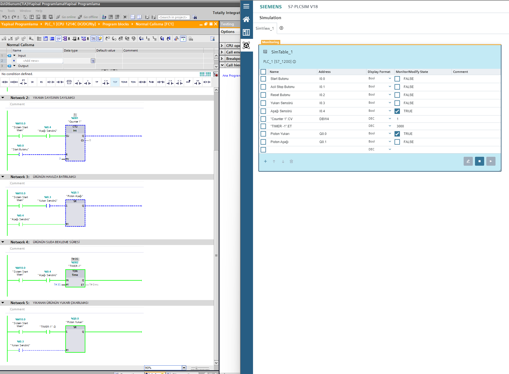
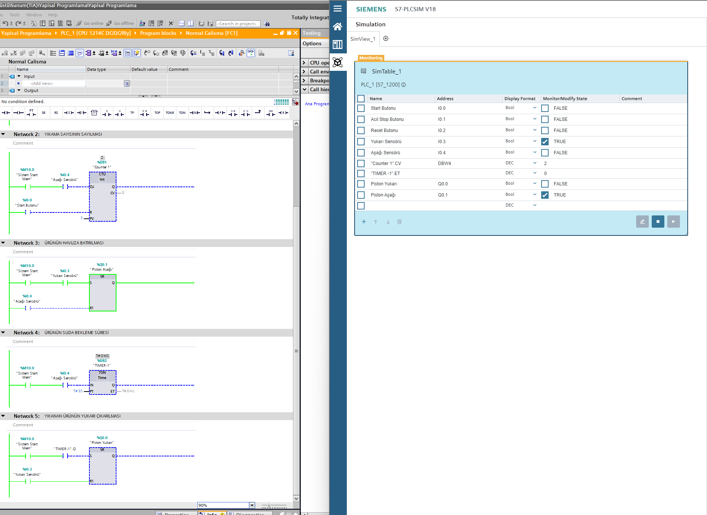
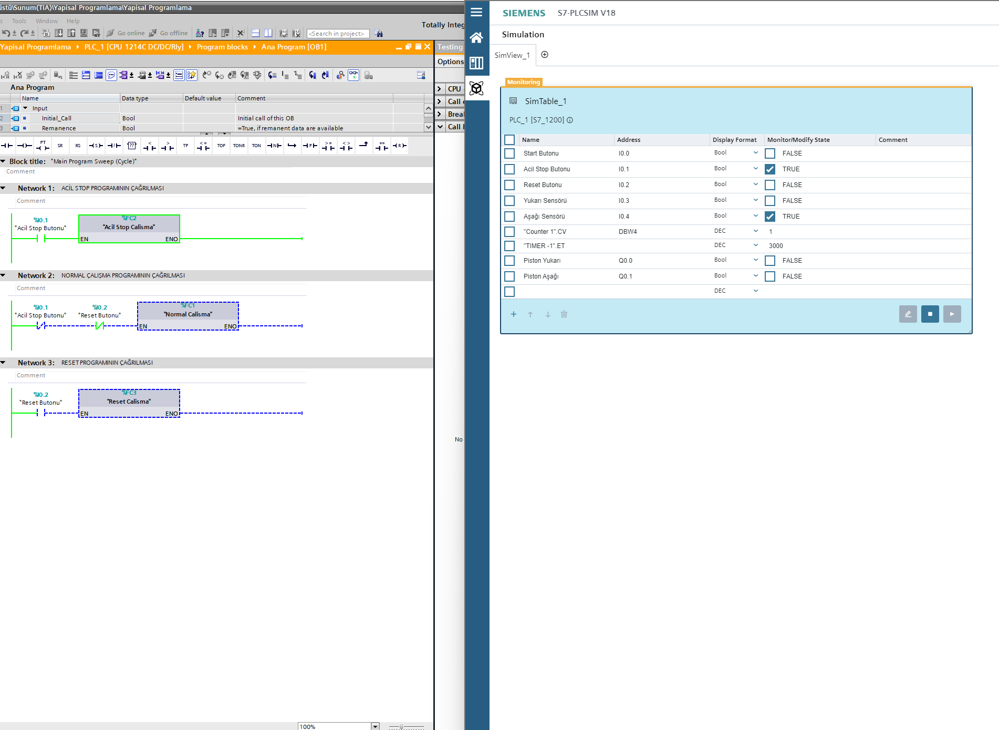
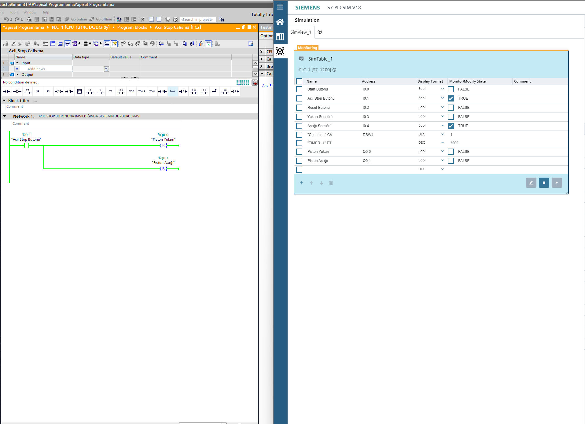
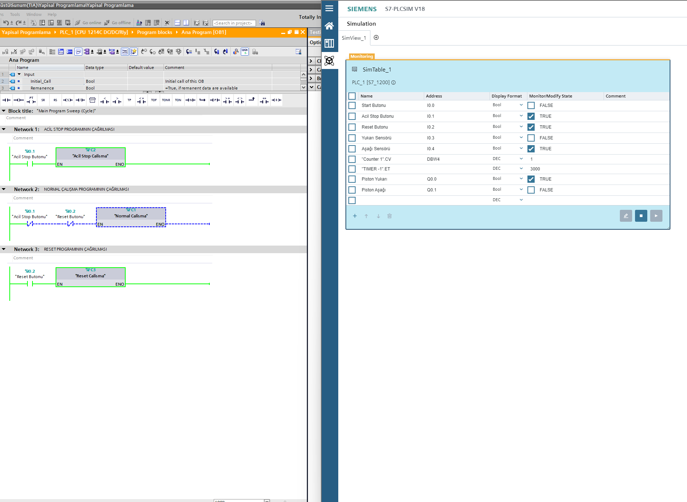
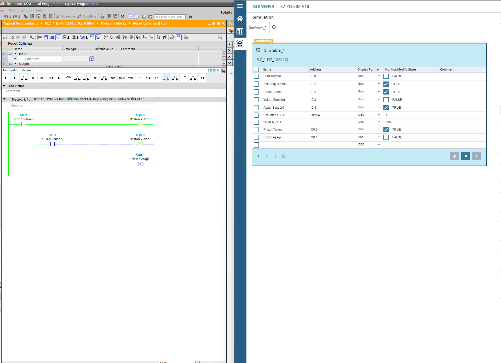

# PLC ile Otomatik Ürün Yıkama Sistemi

## Proje Hakkında

Bu projede, Siemens TIA Portal kullanılarak PLC kontrollü otomatik ürün yıkama sistemi geliştirilmiştir.

Sistem, ürünlerin bir piston yardımıyla yıkama havuzuna daldırılması, belirlenen süre boyunca suda bekletilmesi ve ardından havuzdan çıkarılması prensibine dayanmaktadır.

Yıkama işlemi, PLC programında kullanılan sayaç ve zamanlayıcılar aracılığıyla otomatik olarak tekrarlanmaktadır. Ayrıca sistemde acil durdurma ve başlangıç konumuna döndürme işlevleri bulunmaktadır.

## Kullanılan Yazılımlar ve Donanımlar

- Siemens TIA Portal V18
- Siemens S7-1200 PLC (CPU 1214C DC/DC/Rly)
- Siemens S7-PLCSIM V18
- Ladder (LAD) programlama dili
- CTU sayaç ve TON zamanlayıcı
- SR hafıza blokları
- Start, acil stop ve reset butonları
- Piston ve konum sensörleri

## Sistemin Çalışma Prensibi

1. Start butonuna basılarak otomatik yıkama işlemi başlatılır.
2. Piston, ürünü yıkama havuzuna indirir.
3. Aşağı konum sensörü algılama yaptığında zamanlayıcı devreye girer.
4. Ürün, havuzda 3 saniye bekletilir.
5. Bekleme süresi tamamlandığında piston ürünü yukarı çıkarır.
6. Yukarı konum sensörü algılama yaptığında yıkama döngüsü tamamlanır.
7. Sayaç yardımıyla yıkama işlemi toplam 3 döngü olacak şekilde kontrol edilir.
8. Acil stop butonuyla çalışma durdurulabilir. Reset butonuyla piston başlangıç konumuna getirilebilir.

## PLC Giriş ve Çıkış Adresleri

| Değişken | Adres | Açıklama |
|---|---|---|
| Start Butonu | %I0.0 | Sistemi başlatır |
| Acil Stop Butonu | %I0.1 | Acil durdurma komutunu verir |
| Reset Butonu | %I0.2 | Başlangıç konumuna dönüşü başlatır |
| Yukarı Sensörü | %I0.3 | Pistonun üst konumunu algılar |
| Aşağı Sensörü | %I0.4 | Pistonun alt konumunu algılar |
| Piston Yukarı | %Q0.0 | Pistonun yukarı hareketini kontrol eder |
| Piston Aşağı | %Q0.1 | Pistonun aşağı hareketini kontrol eder |
| Sistem Start Mem | %M10.0 | Sistem başlatma hafızası |

## PLC Program Yapısı

Program, daha düzenli ve anlaşılır olması amacıyla fonksiyon bloklarına ayrılmıştır.

- **OB1 – Ana Program:** Normal çalışma, acil stop ve reset programlarının çağrılması.
- **FC1 – Normal Çalışma:** Piston hareketleri, yıkama süresi ve döngü sayısının kontrol edilmesi.
- **FC2 – Acil Stop Çalışma:** Acil durdurma komutunda piston çıkışlarının sıfırlanması.
- **FC3 – Reset Çalışma:** Pistonun başlangıç konumuna getirilmesi.

## Proje Görselleri

### 1. PLC Değişken Tablosu

Sistemde kullanılan giriş, çıkış ve hafıza değişkenlerinin adresleri gösterilmektedir.

### 2. Ana Program (OB1)

Normal çalışma, acil stop ve reset fonksiyonlarının ana program üzerinden çağrılması gösterilmektedir.

### 3. Sistem Başlatma ve Sayaç Kontrolü

Start butonu, sistem hafızası ve yıkama sayısını kontrol eden CTU sayacının çalışma durumu gösterilmektedir.

### 4. Birinci Yıkama Döngüsü

Yıkama işlemi sırasında piston hareketleri, konum sensörleri ve zamanlayıcının çalışma durumu gösterilmektedir.

### 5. İkinci Yıkama Döngüsü

Yıkama işleminin tekrarlanması ve sayaç değerinin artması gösterilmektedir.

### 6. Acil Stop Kontrolü

Acil stop butonuna basıldığında normal çalışma programının devre dışı bırakılması gösterilmektedir.

### 7. Acil Stop Simülasyonu

Acil stop komutu sırasında pistonun yukarı ve aşağı hareket çıkışlarının sıfırlanması gösterilmektedir.

### 8. Reset Programının Çalıştırılması

Reset butonuna basıldığında sistemin başlangıç konumuna dönmesini sağlayan programın çalıştırılması gösterilmektedir.

### 9. Reset Simülasyonu

Reset komutu sonrasında pistonun yukarı hareketinin etkinleştirilmesi ve aşağı hareketinin devre dışı bırakılması gösterilmektedir.

## Proje Dosyası

Projenin TIA Portal arşiv dosyası depo içerisinde bulunmaktadır.

**Dosya:** `PLC ile Otomatik Ürün Yıkama Sistemi.zap18`

Arşiv dosyası TIA Portal V18 üzerinden açılarak PLC programı incelenebilir.

## Proje Kapsamında Uygulanan Konular

- PLC ile otomatik sıralı kontrol
- Ladder programlama
- Giriş ve çıkış adresleme
- SR hafıza kullanımı
- CTU ile döngü sayma
- TON ile süre kontrolü
- Piston hareket kontrolü
- Konum sensörleriyle geri bildirim
- Fonksiyon bloklarıyla modüler programlama
- Acil durdurma ve reset mantığı
- S7-PLCSIM ile program simülasyonu

## Not

Bu proje, PLC programlama ve endüstriyel otomasyon uygulamalarını öğrenmek amacıyla simülasyon ortamında geliştirilmiştir.

Gerçek bir makinede acil durdurma işlevi yalnızca standart PLC yazılımına bırakılmamalı; uygun güvenlik donanımları ve risk değerlendirmesiyle tasarlanmalıdır.
